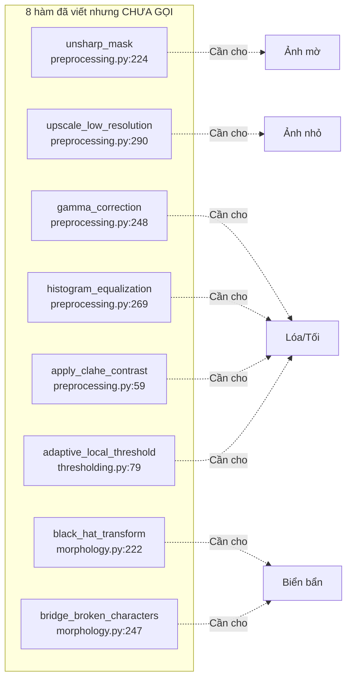

# KIỂM TRA CODE TIỀN XỬ LÝ ẢNH — 12 LỖI CẦN SỬA

> [!IMPORTANT]
> Đối chiếu trực tiếp từ code trong `LicensePlateDetection/`. Mỗi lỗi ghi rõ **file → dòng → code lỗi → hậu quả → cách sửa**.

---

## NHÓM A: ẢNH BỊ NGHIÊNG (3 lỗi)

### 🔴 LỖI A1 — Pipeline chỉ dùng `sobel_x`, mù cạnh nghiêng

**File:** `LicensePlateDetection/main.py` (dòng 162)

```python
# Code hiện tại — Bước 2 chỉ có Sobel-X:
sobel_x_np = sobel_x(blurred_np)          # ← Chỉ bắt cạnh đứng 90°
```

**Hậu quả:** Khi biển số nghiêng $25°-45°$, nét chữ bị xiên. Biên độ Sobel-X giảm theo $\cos(\theta)$. Ở $45°$ chỉ còn $\approx 70\%$ biên độ, nhiều nét chữ rơi dưới ngưỡng Otsu → biển số bị xóa sạch sau nhị phân hóa.

**Nhận xét:** Code đã viết hàm `combined_sobel` (trong `edge_detection.py`) và có nhánh phụ dùng nó ở dòng 233-261 trong `main.py`, nhưng nhánh phụ chỉ bổ sung ứng viên có `|angle| >= 20°`. Pipeline chính vẫn dùng `sobel_x` thuần.

**Cách sửa:** Chạy cả 2 luồng song song ngay từ đầu:
```python
# BƯỚC 2: Chạy 2 luồng song song
sobel_x_np = sobel_x(blurred_np)

# Luồng phụ Combined Sobel cho biển nghiêng
sob_comb = combined_sobel(blurred_np, weight_x=0.8, weight_y=0.4)

# Bước 3-5 chạy trên CẢ HAI, gộp ứng viên ở Bước 6
```

---

### 🔴 LỖI A2 — `order_quad_points` sai khi biển xoay góc lớn

**File:** `LicensePlateDetection/utils/image_utils.py` (dòng 33-46)

```python
# Sắp xếp theo Y tăng dần rồi chia 2 cặp trên-dưới:
y_sorted = pts_arr[np.argsort(pts_arr[:, 1])]
top_two = y_sorted[:2]    # ← 2 điểm Y nhỏ nhất = "cạnh trên"
tl = top_two[np.argmin(top_two[:, 0])]
tr = top_two[np.argmax(top_two[:, 0])]
```

**Hậu quả:** Khi biển xoay $> 40°$, 2 điểm có $Y$ nhỏ nhất không phải cạnh trên mà là đỉnh trên + một đỉnh bên hông. Thứ tự `[TL, TR, BR, BL]` bị tráo đổi → `warpPerspective` cắt ra ảnh bị **xoay ngược hoặc lật ngang**. Đúng với lỗi ghi trong `error_image.docx`: *"sai chọn góc xoay ngược"*.

**Cách sửa:** Dùng thuật toán tổng-hiệu tọa độ (chuẩn OpenCV):
```python
def order_quad_points(pts):
    pts_arr = np.array(pts, dtype="float32")
    rect = np.zeros((4, 2), dtype="float32")
    
    s = pts_arr.sum(axis=1)      # x + y
    d = np.diff(pts_arr, axis=1)  # x - y (hoặc y - x)
    
    rect[0] = pts_arr[np.argmin(s)]    # TL: x+y nhỏ nhất
    rect[2] = pts_arr[np.argmax(s)]    # BR: x+y lớn nhất
    rect[1] = pts_arr[np.argmin(d)]    # TR: y-x nhỏ nhất
    rect[3] = pts_arr[np.argmax(d)]    # BL: y-x lớn nhất
    
    return rect
```

---

### 🟡 LỖI A3 — `np.roll` đảo đỉnh gây lộn ảnh

**File:** `LicensePlateDetection/utils/image_utils.py` (dòng 232-233)

```python
if target_w < target_h:
    corners_orig = np.roll(corners_orig, 1, axis=0)  # ← BL→TL, TL→TR, TR→BR, BR→BL
```

**Hậu quả:** `np.roll(..., 1)` dịch vòng 1 bước, biến góc dưới-trái (BL) thành góc trên-trái (TL) khi warp. Ảnh cắt ra bị **quay lệch 90° theo chiều sai**.

**Cách sửa:** Tính lại chiều rộng/cao thực tế bằng cách swap:
```python
if target_w < target_h:
    # Chỉ swap kích thước đích, KHÔNG xoay các đỉnh
    target_w, target_h = target_h, target_w
```

---

## NHÓM B: ẢNH BỊ MỜ (2 lỗi)

### 🔴 LỖI B1 — Luôn Gaussian Blur cố định, mờ chồng mờ

**File:** `LicensePlateDetection/main.py` (dòng 143-148)

```python
# 1.3 Khử nhiễu bằng bộ lọc Gaussian
blurred_np = gaussian_blur(
    gray_np,
    kernel_size=config.GAUSSIAN_KERNEL_SIZE,  # = 5
    sigma=config.GAUSSIAN_SIGMA               # = 1.0
)
```

**Hậu quả:** Ảnh vốn đã mờ do chuyển động / lấy nét sai lại bị làm mờ thêm → nét ký tự bị triệt tiêu hoàn toàn → Sobel-X không bắt được cạnh → biển số mất sạch.

**Cách sửa:** Thêm bước đo độ nét, nếu mờ thì làm nét thay vì làm mờ:
```python
from image_processing.preprocessing import unsharp_mask

# 1.3 Đánh giá độ nét ảnh bằng Laplacian Variance
laplacian_var = np.var(convolve2d(gray_np, np.array([[0,1,0],[1,-4,1],[0,1,0]], dtype=np.float32)))

if laplacian_var < 300.0:  # Ảnh mờ → Làm nét thay vì làm mờ
    blurred_np = unsharp_mask(gray_np, amount=1.5, kernel_size=3, sigma=0.8)
else:  # Ảnh nét bình thường → Khử nhiễu Gaussian như cũ
    blurred_np = gaussian_blur(gray_np, kernel_size=5, sigma=1.0)
```

---

### 🟡 LỖI B2 — `unsharp_mask` đã viết nhưng không được gọi ở đâu trong pipeline

**File viết:** `LicensePlateDetection/image_processing/preprocessing.py` (dòng 224-245) — Hàm tồn tại

**File dùng:** `LicensePlateDetection/main.py` — Không import, không gọi

**Hậu quả:** Bạn đã đầu tư viết thuật toán khôi phục ảnh mờ nhưng không tích hợp vào luồng chính. Toàn bộ ảnh mờ đều bị xử lý sai.

**Cách sửa:** Import và gọi trong `main.py` (xem LỖI B1 ở trên).

---

## NHÓM C: ẢNH BẨN / BIỂN VÀNG (3 lỗi)

### 🔴 LỖI C1 — Ngưỡng sáng `dynamic_min_brightness` quá cao, loại nhầm biển vàng bẩn

**File:** `LicensePlateDetection/image_processing/candidate_filter.py` (dòng 495-496)

```python
mean_img = float(np.mean(full_gray))
dynamic_min_brightness = max(60.0, mean_img * 0.80)  # ← Ảnh ngoài nắng: mean ≈ 150 → ngưỡng = 120
```

**Hậu quả:** Ảnh chụp ban ngày nắng gắt có `mean_img ≈ 150`, đẩy ngưỡng lên $120$. Biển vàng dính bùn/biển cũ phai màu có `mean_ROI ≈ 80-100` bị đánh giá là "vùng tối rác" và **loại bỏ hoàn toàn** ở dòng 590. Khớp với lỗi: *"Không nhận diện được biển vàng hơi bị bẩn"*.

**Cách sửa:** Giảm hệ số nhân và thêm kiểm tra tương phản:
```python
mean_img = float(np.mean(full_gray))
dynamic_min_brightness = max(45.0, mean_img * 0.55)

# Bổ sung: Cho qua nếu vùng ROI có tương phản cao (có ký tự bên trong)
p10, p90 = np.percentile(roi_gray, (10, 90))
has_contrast = (p90 - p10) >= 40.0
return (mean_val >= dynamic_min_brightness) or has_contrast
```

---

### 🔴 LỖI C2 — `black_hat_transform` và `bridge_broken_characters` viết xong nhưng không gọi

**File viết:**
- `LicensePlateDetection/image_processing/morphology.py` (dòng 222-233) — `black_hat_transform`
- `LicensePlateDetection/image_processing/morphology.py` (dòng 247-256) — `bridge_broken_characters`

**File import nhưng không gọi:**
- `LicensePlateDetection/image_processing/character_recognition.py` (dòng 36): `from .morphology import bridge_broken_characters` — chỉ import, **không dùng ở bất kỳ dòng nào**.

**File không import:** `main.py` không import `black_hat_transform`.

**Hậu quả:** Biển dính bùn, nét chữ bị đứt do trầy xước hoàn toàn không được xử lý → ký tự bị mất nét → OCR sai hoặc không nhận dạng.

**Cách sửa:** Tích hợp vào `binarize_cropped_plate`:
```python
def binarize_cropped_plate(cropped_pil):
    # ... (giữ nguyên code hiện tại đến dòng char_bin = (enhanced < t_opt))
    
    # BỔ SUNG: Hàn gắn nét đứt cho biển bẩn/trầy xước
    char_bin_uint8 = (char_bin.astype(np.uint8) * 255)
    char_bin_uint8 = bridge_broken_characters(char_bin_uint8, gap_size=3)
    char_bin = (char_bin_uint8 > 0)
    
    # BỔ SUNG: Black-Hat bóc tách ký tự trên biển bẩn loang
    from .morphology import black_hat_transform, create_structuring_element
    se_bh = create_structuring_element(5, 5, 'ellipse')
    bh = black_hat_transform(enhanced, se_bh)
    bh_bin = (bh > 25)
    char_bin = char_bin | bh_bin  # Union để không mất nét chữ
    
    # ... (giữ nguyên khử viền mép)
```

---

### 🟡 LỖI C3 — `adaptive_local_threshold` (Sauvola) viết xong nhưng không gọi

**File viết:** `LicensePlateDetection/image_processing/thresholding.py` (dòng 79-143) — 65 dòng code Sauvola hoàn chỉnh.

**Nơi gọi:** KHÔNG có file nào gọi hàm này.

**Hậu quả:** Ảnh bị lóa sáng cục bộ (đèn flash, phản quang mặt trời) làm Otsu toàn cục bị lệch ngưỡng. Vùng chói bão hòa trắng nuốt mất nét chữ, trong khi vùng tối không đủ ngưỡng → biển số mất hoàn toàn.

**Cách sửa:** Tích hợp Sauvola vào `binarize_cropped_plate` song song với Otsu:
```python
from .thresholding import adaptive_local_threshold

# Trong binarize_cropped_plate, sau dòng char_bin = (enhanced < t_opt):
sauvola_bin = adaptive_local_threshold(enhanced, block_size=25, k=0.2)
sauvola_mask = (sauvola_bin == 0)  # Inverse: ký tự = đen = 0 trong sauvola
char_bin = char_bin | sauvola_mask  # Kết hợp cả 2 kết quả
```

---

## NHÓM D: ẢNH NHỎ / ZOOM TO (2 lỗi)

### 🔴 LỖI D1 — `upscale_low_resolution` viết xong nhưng không gọi

**File viết:** `LicensePlateDetection/image_processing/preprocessing.py` (dòng 290-318) — Hàm nội suy Bicubic + Unsharp Masking.

**Nơi gọi:** KHÔNG CÓ.

**Hậu quả:** Ảnh chụp từ xa, biển số chỉ cao $30-50$ px. Nét chữ chỉ rộng $2-3$ px. Sau khi Sobel-X, cạnh chỉ $1-2$ px, bị Otsu và Closing nuốt mất hoàn toàn.

**Cách sửa:** Gọi trước khi cắt biển số đưa vào OCR, trong `main.py` (dòng 324-330):
```python
from image_processing.preprocessing import upscale_low_resolution

# Sau khi crop xong biển số, trước khi gọi OCR:
crop_np = np.array(crop_std)
if crop_np.ndim == 3:
    from image_processing.preprocessing import rgb_to_grayscale
    crop_gray = rgb_to_grayscale(crop_np)
else:
    crop_gray = crop_np

if crop_gray.shape[0] < 80:  # Biển số quá nhỏ
    crop_up, _ = upscale_low_resolution(crop_np, min_height=120)
    crop_std = Image.fromarray(crop_up)

ocr_std = recognize_license_plate(crop_std, plate_type=cand['plate_type'])
```

---

### 🔴 LỖI D2 — Kernel Closing $3 \times 19$ cố định, phá ảnh nhỏ

**File:** `LicensePlateDetection/config.py` (dòng 69-70)

```python
CLOSING_KERNEL_HEIGHT = 3
CLOSING_KERNEL_WIDTH = 19     # ← Cố định 19 pixel
```

**File dùng:** `LicensePlateDetection/main.py` (dòng 177-182) — Dùng trực tiếp giá trị cố định.

**Hậu quả:** Trên ảnh 900px cạnh dài, biển số rộng $\approx 200$ px → kernel $19$ px chiếm $\approx 10\%$ → hợp lý. Nhưng trên ảnh nhỏ $320$ px, biển số chỉ rộng $\approx 50$ px → kernel $19$ px chiếm **$38\%$** → biển số bị gộp dính với cản xe, thân xe, thành một khối.

**Cách sửa:** SE co giãn tỉ lệ theo kích thước ảnh:
```python
# Trong main.py, sau khi có resized_np:
img_h, img_w = resized_np.shape[:2]
scale_ratio = max(img_w, img_h) / 900.0  # Tỷ lệ so với ảnh chuẩn 900px

closing_w = max(7, int(round(config.CLOSING_KERNEL_WIDTH * scale_ratio)))
if closing_w % 2 == 0:
    closing_w += 1  # Đảm bảo số lẻ

se_close = create_structuring_element(
    height=config.CLOSING_KERNEL_HEIGHT,
    width=closing_w,
    shape='rect'
)
```

---

## NHÓM E: ÁNH SÁNG VÀ CÁC VẤN ĐỀ KHÁC (2 lỗi)

### 🔴 LỖI E1 — Biển nền tối (xanh/đỏ): Luôn nhị phân hóa Inverse → sai 100%

**File:** `LicensePlateDetection/image_processing/character_recognition.py` (dòng 558)

```python
char_bin = (enhanced < t_opt)  # ← Luôn giả định: ký tự TỐI hơn nền SÁNG
```

**Hậu quả:** Biển xanh (công an), biển đỏ (quân đội) có **nền tối, chữ trắng/vàng**. Công thức `enhanced < t_opt` sẽ bắt nền tối thành "ký tự" và bỏ qua chữ trắng → nhị phân hóa ngược hoàn toàn → OCR trả "KXD".

**Cách sửa:** Phát hiện polarity rồi đảo ngược nếu cần:
```python
# Sau khi tính char_bin = (enhanced < t_opt):
# Kiểm tra tỷ lệ pixel trắng: nếu > 60% là nền tối chữ sáng → đảo ngược
white_ratio = float(np.sum(char_bin)) / float(char_bin.size)
if white_ratio > 0.60:
    char_bin = ~char_bin  # Đảo polarity cho biển nền tối
```

---

### 🟡 LỖI E2 — `normalize_char_patch` kéo méo Aspect Ratio ký tự

**File:** `LicensePlateDetection/image_processing/character_recognition.py` (dòng 64-72)

```python
def normalize_char_patch(arr, target_size=(20, 32)):
    tight = tight_crop_binary(arr)
    # ...
    im = Image.fromarray((tight.astype(np.uint8) * 255), mode="L")
    resized = im.resize(target_size, Image.Resampling.BILINEAR)  # ← Kéo giãn méo
    return (np.array(resized) > 100)
```

**Hậu quả:**
- Ký tự `1` rất mảnh ($AR \approx 0.08$) bị kéo ngang thành khối vuông → nhầm thành `7`, `T`, `L`.
- Ký tự `8`, `B`, `0` có lỗ nhỏ bên trong, nội suy BILINEAR + ngưỡng cứng `> 100` bít lỗ → Euler Holes bị sai ($2 → 1$ hoặc $1 → 0$) → template matching nhầm sang `0`, `6`, `D`.

**Cách sửa:** Padding giữ nguyên Aspect Ratio trước khi resize:
```python
def normalize_char_patch(arr, target_size=(20, 32)):
    tight = tight_crop_binary(arr)
    if tight.shape[0] < 2 or tight.shape[1] < 2:
        return np.zeros((target_size[1], target_size[0]), dtype=bool)
    
    th, tw = tight.shape
    target_w, target_h = target_size
    
    # Giữ nguyên Aspect Ratio, padding phần còn lại bằng False
    scale = min(target_w / tw, target_h / th)
    new_w = max(1, int(round(tw * scale)))
    new_h = max(1, int(round(th * scale)))
    
    im = Image.fromarray((tight.astype(np.uint8) * 255), mode="L")
    resized = im.resize((new_w, new_h), Image.Resampling.BILINEAR)
    
    # Đặt vào giữa canvas 20×32, padding = 0
    canvas = np.zeros((target_h, target_w), dtype=np.uint8)
    y_off = (target_h - new_h) // 2
    x_off = (target_w - new_w) // 2
    canvas[y_off:y_off+new_h, x_off:x_off+new_w] = np.array(resized)
    
    return (canvas > 100)
```

---

## TÓM TẮT TOÀN BỘ 12 LỖI

| # | Mức độ | Nhóm | Tóm tắt lỗi | File & Dòng |
| :---: | :---: | :---: | :--- | :--- |
| A1 | 🔴 | Nghiêng | Pipeline chỉ Sobel-X, mù cạnh nghiêng | `main.py:162` |
| A2 | 🔴 | Nghiêng | `order_quad_points` sai khi xoay lớn | `image_utils.py:33-46` |
| A3 | 🟡 | Nghiêng | `np.roll` đảo đỉnh gây lộn ảnh | `image_utils.py:232` |
| B1 | 🔴 | Mờ | Gaussian Blur cố định, mờ chồng mờ | `main.py:143-148` |
| B2 | 🟡 | Mờ | `unsharp_mask` viết nhưng không gọi | `preprocessing.py:224` |
| C1 | 🔴 | Bẩn | Ngưỡng sáng quá cao loại nhầm biển vàng | `candidate_filter.py:496` |
| C2 | 🔴 | Bẩn | `black_hat` + `bridge_broken` không gọi | `morphology.py:222,247` |
| C3 | 🟡 | Bẩn | Sauvola viết xong không gọi | `thresholding.py:79` |
| D1 | 🔴 | Nhỏ | `upscale_low_resolution` không gọi | `preprocessing.py:290` |
| D2 | 🔴 | Nhỏ | Kernel Closing cố định phá ảnh nhỏ | `config.py:69-70` |
| E1 | 🔴 | Sáng | Biển nền tối luôn bị nhị phân ngược | `char_recognition.py:558` |
| E2 | 🟡 | Khác | `normalize_char_patch` méo AR ký tự | `char_recognition.py:64-72` |



> [!CAUTION]
> **Vấn đề lớn nhất:** Bạn đã đầu tư viết **8 hàm xử lý nâng cao** (unsharp\_mask, upscale, gamma, histogram\_eq, CLAHE, Sauvola, black\_hat, bridge\_broken) nhưng **không hàm nào được tích hợp vào pipeline chính** `main.py` hoặc `character_recognition.py`. Toàn bộ pipeline vẫn chạy chuỗi cố định: Gaussian Blur → Sobel-X → Otsu → Closing 3×19 → Opening 3×3 cho mọi loại ảnh.
