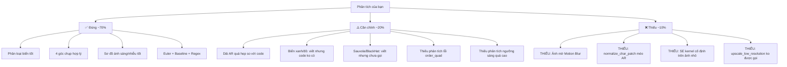

# ĐÁNH GIÁ BÀI PHÂN TÍCH TIỀN XỬ LÝ ẢNH — Hệ Thống Nhận Dạng Biển Số Xe

> [!NOTE]
> Đối chiếu giữa nội dung phân tích của bạn với mã nguồn thực tế trong `LicensePlateDetection/`.
> Mỗi mục đánh giá: ✅ Đúng, ⚠️ Đúng nhưng cần chỉnh sửa/bổ sung, ❌ Sai hoặc thiếu nghiêm trọng.

---

## PHẦN 1: PHÂN LOẠI THEO QUY CHUẨN LOẠI XE VÀ LOẠI BIỂN

### ✅ Đúng
- Bảng phân loại 4 loại biển (Xe máy 2 dòng, Ô tô dải dài, Ô tô vuông, Xe vận tải) là hợp lý và bám sát thực tế Việt Nam.
- Nhận dạng đặc điểm riêng từng loại: ốc vít, chữ phấn bãi xe, nan lưới tản nhiệt.
- Chiến lược Inverse Otsu ($P < T$) cho biển trắng/vàng vs. Thuận Otsu ($P > T$) cho biển xanh/đỏ.

### ⚠️ Cần chỉnh sửa

| Nội dung bạn viết | Giá trị trong code thực tế | Ghi chú |
| :--- | :--- | :--- |
| Xe máy $W/H = 1.20 - 1.50$ | `DOUBLE_ROW_ASPECT_RATIO_MIN = 1.00`, `MAX = 2.25` (`config.py`) | Dải bạn ghi **quá hẹp**. Code cho phép $1.00 - 2.25$ vì biển nghiêng/chụp từ dưới lên có AR bị thay đổi. Nên sửa thành "$1.00 - 2.25$ (mở rộng cho nghiêng)" |
| Ô tô dải dài $W/H = 3.50 - 5.50$ | `SINGLE_ROW_ASPECT_RATIO_MIN = 2.45`, `MAX = 6.0` (`config.py`) | Dải bạn ghi **quá hẹp**. Code cho phép $2.45 - 6.0$. Nên sửa lại |
| Ô tô vuông $W/H = 1.40 - 1.90$ | Nằm trong dải `DOUBLE_ROW` = $1.00 - 2.25$ | Dải bạn ghi hẹp hơn code thực tế |
| Biển Xanh/Đỏ: "Bắt buộc dùng Nhị phân hóa Thuận Otsu ($P > T$)" | Code **KHÔNG** triển khai riêng biện pháp phân ngưỡng theo màu nền biển | ❌ **Sai thực tế so với code.** Trong `binarize_cropped_plate`, chỉ kiểm tra `is_yellow` (biển vàng) để điều chỉnh kênh Grayscale. Không có logic phát hiện biển xanh/đỏ nền tối. |

### ❌ Thiếu nghiêm trọng
- **Bạn chưa đề cập đến việc code KHÔNG xử lý được biển nền tối (xanh/đỏ).** Đây là gap lớn giữa phân tích lý thuyết và thực tế. Hàm `binarize_cropped_plate` luôn giả định nền sáng chữ tối (`char_bin = (enhanced < t_opt)`), khiến biển xanh/đỏ bị nhị phân hóa ngược hoàn toàn → OCR trả về toàn "KXD".

---

## PHẦN 2: PHÂN LOẠI THEO GÓC CHỤP VÀ BIẾN DẠNG HÌNH HỌC

### ✅ Đúng
- Phân chia 4 trường hợp ($0°-10°$, $15°-35°$, $45°-90°$, cự ly xa) là hợp lý.
- Giải pháp OBB → Quad Points → warpPerspective cho biển nghiêng.
- Công thức True Aspect Ratio = $\max/\min$ cho biển xoay dọc.
- Combined Sobel ($\sqrt{0.8 G_x^2 + 0.4 G_y^2}$) bắt nét ký tự xoay — khớp chính xác với `combined_sobel`.
- Upscale Bicubic/Lanczos + Unsharp Masking cho ảnh nhỏ.

### ⚠️ Cần chỉnh sửa / bổ sung

**1. Trường hợp 2 (Chụp xiên $15°-35°$): Thiếu đề cập lỗi `order_quad_points`**

Bạn viết "Sắp xếp 4 đỉnh chuẩn theo thứ tự [TL, TR, BR, BL] dựa trên tọa độ trục $Y$" — đúng là logic trong code, nhưng bạn **chưa phân tích lỗi** của chính thuật toán này. Khi góc nghiêng lớn, 2 điểm có $Y$ nhỏ nhất không nhất thiết là cạnh trên thực sự của biển số. Cần bổ sung:

> ⚠️ **Hạn chế thuật toán hiện tại:** Sắp xếp theo trục $Y$ chỉ đúng khi góc nghiêng $< 45°$. Khi biển xoay gần $45° - 90°$, cần chuyển sang sắp xếp theo tổng/hiệu tọa độ $(x+y, x-y)$ hoặc theo góc cực để đảm bảo thứ tự đỉnh nhất quán.

**2. Trường hợp 2: Thiếu đề cập lỗi `np.roll` trong `crop_license_plate`**

Trong `image_utils.py`:
```python
if target_w < target_h:
    corners_orig = np.roll(corners_orig, 1, axis=0)
```
Dịch chuyển vòng 1 phần tử (`BL → TL, TL → TR...`) là phép xoay tuỳ tiện, gây ra hiện tượng "sai chọn góc xoay ngược" mà `error_image.docx` đã ghi nhận.

**3. Trường hợp 4 (Cự ly xa): Thiếu 2 điểm quan trọng**

- **Hàm `upscale_low_resolution` đã được viết nhưng KHÔNG được gọi trong pipeline.** Đây là gap giữa "giải pháp thiết kế" và "code triển khai". Cần nói rõ trong phân tích.
- **Thiếu đề cập Structuring Element cố định.** Kernel Closing $3 \times 19$ hoạt động tốt trên ảnh 900px nhưng sẽ **phá hỏng** ảnh nhỏ vì tỷ lệ kernel/biển số quá lớn. Cần SE co giãn theo kích thước ảnh.

---

## PHẦN 3: PHÂN LOẠI THEO ĐIỀU KIỆN ÁNH SÁNG VÀ NHIỄU VẬT LÝ

### ✅ Đúng
- Sơ đồ định tuyến 4 nhánh (thiếu sáng, lóa sáng, nhiễu vật thể, dính bùn) rõ ràng.
- CLAHE + Dynamic Brightness cho thiếu sáng.
- Euler Hole Count + Baseline Variance + Regex VN cho nhiễu vật thể — đã có trong code.
- Black-Hat Transform + Bridge Broken Characters cho biển bẩn.

### ⚠️ Cần chỉnh sửa

**1. Trường hợp 1 (Thiếu sáng): Công thức ngưỡng sáng cần phân tích thêm**

Bạn ghi: $\text{Min Brightness} = \max(60.0, Mean_{image} \times 0.80)$

Đúng — đây là công thức trong `candidate_filter.py`. Nhưng bạn **chưa phân tích vấn đề** của nó:
- Khi ảnh chụp ban ngày nắng gắt, `mean_img ≈ 150`, khiến `min_brightness ≈ 120`. Biển vàng bị bẩn có `mean_ROI ≈ 80-100` sẽ **bị loại nhầm**.
- Cần bổ sung: "Ngưỡng này quá cao cho biển vàng/bẩn; nên dùng thêm kiểm tra tương phản cục bộ."

**2. Trường hợp 2 (Lóa sáng): Sauvola CHƯA được tích hợp**

Bạn viết "Chuyển sang phân ngưỡng cục bộ Sauvola Adaptive Thresholding thay cho Otsu toàn cục" — đây là **giải pháp đề xuất**, nhưng code thực tế:
- `adaptive_local_threshold` đã viết sẵn.
- Nhưng **không được gọi ở đâu** trong `main.py` hay `character_recognition.py`.

Cần ghi rõ: "Thuật toán đã cài đặt nhưng chưa tích hợp vào pipeline chính."

**3. Trường hợp 4 (Biển bẩn): Tương tự — code có nhưng chưa gọi**

- `black_hat_transform` đã viết trong `morphology.py` nhưng **không được gọi** trong pipeline.
- `bridge_broken_characters` chỉ được **import** trong `character_recognition.py` nhưng **không hề được gọi** (chỉ `from .morphology import bridge_broken_characters` ở dòng 36, không có chỗ nào sử dụng).

### ❌ Thiếu — Các trường hợp bạn chưa phân tích

**a. Ảnh bị mờ do chuyển động (Motion Blur / Out-of-Focus)**

Bạn **hoàn toàn không đề cập** đến trường hợp ảnh mờ trong Phần 3. Đây là thách thức thực tế rất phổ biến (xe đang chạy, camera rung). Cần bổ sung:

> **Trường hợp 5: Ảnh mờ do chuyển động / Lấy nét sai**
> - Hình thái: Biên nét chữ bị nhòe, gradient chuyển tiếp thoải, chi tiết tần số cao bị mất.
> - Giải pháp: Kiểm tra độ nét bằng Laplacian Variance. Nếu mờ → gọi `unsharp_mask` trước Gaussian Blur, hoặc giảm/bỏ Gaussian Blur. Hạ sigma Gaussian xuống $0.5$.
> - **Gap hiện tại:** Hàm `unsharp_mask` đã viết nhưng pipeline luôn áp Gaussian Blur cố định → làm mờ chồng mờ.

**b. Bước chuẩn hóa ký tự bị méo tỷ lệ (Aspect Ratio Distortion)**

Bạn chưa phân tích vấn đề trong `normalize_char_patch`:
```python
resized = im.resize(target_size, Image.Resampling.BILINEAR)
return (np.array(resized) > 100)
```
- Ký tự `1` rất mảnh ($w/h \approx 0.08$) bị kéo ngang thành khối vuông khi chuẩn hóa về $20 \times 32$.
- Ký tự `8`, `B`, `0` có lỗ nhỏ bị bít kín do nội suy BILINEAR + ngưỡng cứng `> 100`.
- Cần bổ sung: **Padding giữ nguyên Aspect Ratio** thay vì resize méo.

---

## PHẦN 4: BẢNG TÓM TẮT ĐỊNH TUYẾN

### ✅ Đúng
- Cấu trúc bảng rõ ràng, mỗi tình huống có thuật toán + đầu ra kỳ vọng.
- Dòng "Số 7 bị nhầm thành 3" với Structural Profile Check $P[-5:, :].mean() < 0.22$ — khớp với logic trong `disambiguate_character_v2`.

### ⚠️ Cần bổ sung thêm các dòng

| Tình huống | Thuật toán cần bổ sung | Lý do |
| :--- | :--- | :--- |
| Ảnh bị mờ / Nhòe nét | Laplacian Variance → Unsharp Masking → Giảm/bỏ Gaussian | Chưa có trong bảng |
| Biển nền tối (xanh/đỏ) | Phát hiện nền tối → Đảo Polarity → Thuận Otsu | Chưa có code lẫn phân tích |
| Ảnh nhỏ + Kernel cố định | Adaptive SE Scaling theo $\text{height}_{img}$ | Chưa đề cập |
| Normalize ký tự méo AR | Aspect-Ratio-Preserving Padding + BILINEAR | Chưa đề cập |

---

## TỔNG KẾT ĐÁNH GIÁ



### Checklist hoàn thiện

- [ ] **Sửa dải AR** trong bảng loại biển cho khớp config thực tế ($1.00-2.25$ và $2.45-6.0$)
- [ ] **Bổ sung Trường hợp 5**: Ảnh mờ / Motion Blur — thiếu hoàn toàn
- [ ] **Ghi rõ gap code**: Các hàm `upscale_low_resolution`, `adaptive_local_threshold`, `black_hat_transform`, `bridge_broken_characters` đã viết nhưng chưa được gọi
- [ ] **Bổ sung phân tích lỗi**: `order_quad_points` sai khi nghiêng lớn, `np.roll` gây lộn ngược
- [ ] **Bổ sung**: Normalize ký tự méo Aspect Ratio → lỗi OCR hàng loạt
- [ ] **Bổ sung**: SE Closing cố định $3 \times 19$ phá hỏng ảnh nhỏ
- [ ] **Sửa**: Biển nền tối (xanh/đỏ) — code hiện tại KHÔNG hỗ trợ, không nên viết "Bắt buộc dùng Thuận Otsu" như thể đã có
- [ ] **Bổ sung**: `dynamic_min_brightness` quá cao cho biển vàng bẩn
